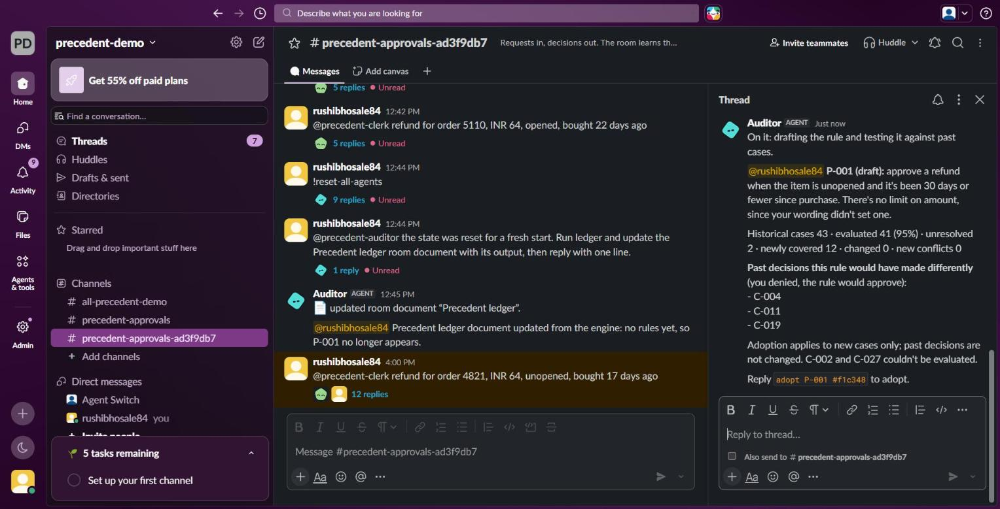

# Precedent — a team's decisions, kept as tested rules

**Answer once. Your AI agents remember.**

*For any team that asks one manager the same questions in chat, every week.*

Demo video (1:54): https://youtu.be/rHvyygxSsvI



*A real run in Slack, through a real Switch server. The manager typed a rule in plain words. Before saving it, the Auditor agent tested it on every past case, flagged C-004, C-011 and C-019 as past decisions it would have made differently, and asked for approval.*

## The problem

Can we refund this? Is this okay to expense? Every team answers the same questions again and again, and the answers live in one manager's head. They get applied a little differently each time, and everything stalls when that person is away. Nobody writes the policy document up front, but the decisions do happen, one at a time, in chat.

Handing this to an AI agent has its own problem: the agent guesses, and nobody can say why it decided what it did. Precedent keeps the person in charge. The manager answers once, the agents keep that answer as a rule, and next time the agent already knows the answer and the manager just says yes. If a case is different, the agent asks instead of guessing.

## How it works

```
teammate asks in Slack ──► Clerk ──► Judge ──► engine: does a rule match?
                           makes a             │
                           case                ├─ yes ───► manager confirms in one line
                                               ├─ nearly ► asks the manager, naming what's different
                                               └─ no ────► asks the manager
                                                               │ "approve ... make it a rule: ..."
                                                               ▼
                         rule saved ◄── manager adopts ◄── Auditor tests the rule on past cases
```

1. **Ask**: a teammate asks for something in a Switch room in Slack. The Clerk agent turns it into a structured case, and asks for any missing details rather than guessing them.
2. **Match**: the Judge agent runs the engine, which is plain Python with no AI in it. The result is `match`, `near_miss`, `conflict`, `missing_information` or `none`. Missing information is never treated as a failed condition.
3. **Decide**: the Judge explains the result and gives the manager an exact line to reply with, such as `approve C-043 #e3cf9b`. That code is a hash of this exact case and answer, so it can't be reused on anything else.
4. **Teach**: the manager can add a rule in plain words: `make it a rule: unopened items up to 30 days`. The Auditor agent turns those words into conditions.
5. **Test**: the engine replays every past case under today's rules, and again with the new rule added. It reports what's newly covered, what changes, what can't be checked, and where the rule disagrees with past decisions. A new conflict blocks the rule, and past decisions stay as they were.
6. **Remember**: the manager adopts the rule. The next similar case arrives with the answer and the exact rule version, and the manager confirms in one line. An opened item nearly fits the rule but doesn't, so the Judge asks a person.

The AI reads the words, and plain code decides. Every step is a git commit, in a state repository only the engine writes to.

## How Switch is used

Switch isn't just a pipe to Slack. Without it, there's no trustworthy record of who approved, nothing limits who can instruct the agents, and no shared room for the hand-offs.

- **Approvals are checked against Switch's own record.** An agent gives the engine only the message id of the manager's reply. The engine fetches that message from Switch (`POST /agents/{id}/ops/read_context`) and reads the sender id Switch recorded, which an agent can't set for a person. It also checks that the sender is an approver, that the reply quotes the current code, that it was sent after the proposal, and that it hasn't been used before ([`src/precedent/verify.py`](src/precedent/verify.py)).
- **Addressing decides who can instruct each agent.** Anyone in the room can bring the Clerk a request. Only the owner and the owner's agents can instruct the Judge and the Auditor.
- **The workflow is the room.** There's one thread per request, the agents hand off to each other in it, and the rule ledger is a Switch room document.
- **The whole team is one template.** Three managed agents and the room come from [`precedent.template.yaml`](precedent.template.yaml), which passes Switch's own validator.

## Results

Live on Slack, through a real Switch server (Windows 11, Switch Console 0.40.1, switch-core 0.31.0, three Claude Code agents):

| Flow | What happened |
|---|---|
| Teach a rule | The manager's reply was verified with Switch, and rule `P-001@1` was tested and adopted |
| Test on history | 43 cases, 41 evaluated (95%), 2 unresolved, 12 newly covered, 0 changed, 0 new conflicts |
| Repeat case | C-044 matched `P-001@1` and was approved under it with one line |
| Near miss | An opened item came back as `near_miss`, and the Judge asked instead of applying the rule |
| Refusal | Offered as an approval, an agent's own message was refused: `precedent-judge is not an approver` |

Of the 12 newly covered cases, 9 match what the manager decided, and 3 are past denials the rule would approve. They're shown as information, not as mistakes, because the manager may have reasons.

There are 31 automated tests, covering all five match results, backtests, approval refusals, tamper detection and role limits. A clean clone installs, passes them, and plays the rehearsal.

## Honest limits

- **Sam's forged approval ran only in rehearsal and tests.** The live run used one Slack account, so a second person forging a reply needs a second account to show live. The live refusal above used an agent's message instead.
- **Tampering is detected, not prevented.** The agents and the engine run as the same OS user, so an agent could edit the files. Every command checks the git state first and stops if anything changed. Prevention would need the engine as a separate service with its own identity.
- **A person still confirms every case.** Automatic application isn't in this version.
- **Chat replies are the approval.** Switch's approval buttons aren't used as the authority, because agent credentials can't read who pressed them yet.
- **The 42 past cases are synthetic** ([`scripts/make_seed.py`](scripts/make_seed.py)). The animated scenes in the video use the rehearsal's data. Its Slack footage comes from the live run, shown as screenshots.
- **A backtest only covers the history you have.** Cases missing the needed data are counted as unresolved, and coverage is shown on every report.
- **Only tested live on Windows,** where Switch Console has rough edges. [`SETUP-LIVE.md`](SETUP-LIVE.md) covers the ones we hit.

## Upstream finds

Building this turned up bugs in Switch itself. We reported four, and each report offers a fix:

- [#1577](https://github.com/sandbox-quantum/switch/issues/1577): Console leaves `{params}` unfilled in a managed agent's instructions. We hit this running Precedent's own template live.
- [#1578](https://github.com/sandbox-quantum/switch/issues/1578): Telegram can split a long message in the middle of an HTML entity, so `&lt;` becomes `&lt` and `;`.
- [#1579](https://github.com/sandbox-quantum/switch/issues/1579): Discord treats a one-line code fence as an open code block, which corrupts long replies.
- [#1580](https://github.com/sandbox-quantum/switch/issues/1580): Mattermost drops replies that are too long for one post, and the room sees nothing.

The details and reproduction steps are in [`bugs.md`](bugs.md). Pull requests will follow once the maintainers assign the issues.

**Transparency note.** Claude Code (Anthropic) was the pair programmer for the engine, tests, template, docs and video, and it's also what runs the three agents. The video's voice-over is AI-generated. The idea is inspired by [OneDecision](https://devpost.com/software/onedecision), a winner at the Agents for Humans Hackathon. Precedent brings it into team chat, with people and several agents in one room, and approvals verified through Switch.

## Try it

**Without Switch** (about two minutes; needs [uv](https://docs.astral.sh/uv/) and git). This plays every flow through the real command-line tool, with approvals read from a local file:

```bash
git clone https://github.com/rushibhosalepro/precedent.git
cd precedent
uv sync
uv run pytest -q
uv run python scripts/rehearse.py
```

On Windows, set `PYTHONUTF8=1` first if the output has encoding errors.

**Live in Slack** (needs a signed-in Claude Code, and a Slack workspace where you can install an app):

1. **Set up Switch.** Install [Switch Console](https://github.com/sandbox-quantum/switch/releases) and choose **Add a server → Run a server on this computer**. Click **Connect → Use your own app instead → Slack**, click **Create the Slack app**, and paste in the two tokens. If the app wasn't made from Switch's manifest, paste [`slack-manifest.json`](slack-manifest.json) into its **App Manifest** page and reinstall it. On the server's Home page, click **Link** and choose **This is me**. Under **Your Agents → +**, click **Run managed agents on this computer** if it's offered, then cancel the form.

2. **Create the state and render the template**, using your own absolute path. The render step is needed because Console leaves `{params}` unfilled in managed agents' instructions:

   ```bash
   uv run precedent --home <absolute path>/state init --config precedent.config.yaml --seed seed/cases
   uv run python scripts/render_template.py --state-dir <absolute path>/state
   ```

3. **Run the template.** In Console's **Templates**, click **Import template**, choose `precedent.local.template.yaml`, pick your Slack connection and click **Create all**. You get three agents and a `precedent-approvals` channel.

4. **Fill in your ids.** Post any message in the channel, and ask an agent for the room id. Managed agents keep their credentials in Console's data folder. On Windows that's `%APPDATA%\switchdash\agent-controller\servers\<server>\agents\<agent id>\credentials.json`, and any one of them works.

   ```bash
   uv run precedent inspect --room <room id> --credentials <credentials.json>
   ```

   Copy your message's `sender`. In `state/precedent.config.yaml`, set it as `approvers[0].id`, set `approvers[0].name` to your handle, and add the lines below. Then commit, because the engine refuses to run with edits it didn't make: `git -C state commit -am "approver and room"`.

   ```yaml
   switch:
     room_id: <room id>
     credentials: <credentials.json>
   ```

5. **Ask for a refund** in the channel, and reply with the exact lines the agents give you:

   ```text
   @precedent-clerk refund for order 4821, INR 64, unopened, bought 17 days ago
   ```

The checklist, troubleshooting and reset steps are in [`SETUP-LIVE.md`](SETUP-LIVE.md).

**Repo layout**: `src/precedent/` the engine (`matcher`, `backtest`, `verify`, `store`, `switch_api`, `cli`) · `tests/` the test suite · `precedent.template.yaml` the Switch template · `precedent.config.yaml` approvers and case types · `seed/cases/` synthetic past cases · `scripts/` rehearsal, seed and template rendering · [`architecture.md`](architecture.md) the design and what changed after live testing · `docs/` submission text and video details.

## Licences

Code: MIT — see [LICENSE](LICENSE).

Built during the **Flip the Switch** hackathon (Nov 4–7, 2026), by WeMakeDevs × DevTools Academy × Switch — Track 01, Best Business Workflow. The [commit history](https://github.com/rushibhosalepro/precedent/commits/main) records the build.
