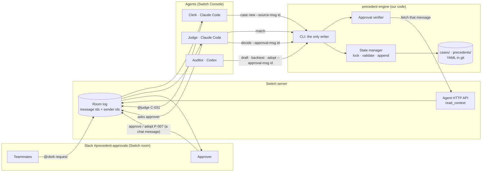

# Precedent: architecture (v2.1, frozen baseline)

Status: **frozen as the MVP baseline (2026-11-04).** Two reviews are folded in: §11 covers the first, §13 the second. From here on, change it only when an integration test proves something wrong, and record the change in §13.

Known limits, accepted for the MVP:
- The engine and agents share an OS user, so §3 detects tampering but can't prevent it.
- Everything here is checked against the Switch repo, not yet against a live server. §12 lists the first integration tests.
Checked against the Switch repo at `e47cab4`: `docs/TEMPLATES.md`, `examples/agent-templates/`, the agent skill (`console/packages/plugins/src/switch-skill/SKILL.md`), and the agent HTTP API (`core/switch_core/bridges/agent/`).

Users: a person asking in chat, a person deciding (the approver), and whoever sets it up once. See [Who it's for](README.md#who-its-for).

**Three non-negotiables (from the review, adopted):**
1. A human's approval is verified **by the engine, from Switch's own record**, never from what an agent says.
2. Every authoritative state change goes **through the engine**, and the engine refuses state it didn't write.
3. A backtest compares **whole policy sets** (active rules vs. active rules plus the draft), never the new rule alone.

---

## 1. The design in one picture



| Layer | Who | Does | Never does |
|---|---|---|---|
| Conversation | Switch room | Carries messages; records who sent each one | Store rules |
| Language | 3 agents | Extract fields, explain results, draft rule conditions from the approver's words | Decide a match; assert who approved |
| Decision + state | `precedent` engine | Validate, match, backtest, **verify approvals with Switch**, write all state | Talk to people |
| Record | YAML + git | Cases (append-only decisions), versioned rules, audit trail | – |

---

## 2. Trust boundary: how an approval is verified (fixes review issue 1)

**The problem.** `precedent adopt P-007 --by priya` trusts an identity typed by an agent.

**The fix.** The agent passes only a **message id**. The engine fetches that message from Switch and checks it itself.

How it works (verified in the Switch code):
- Each agent's Switch credentials live in its working dir at `.switch/agents/<slug>.json` (written by Switch Console; see `console/AGENTS.md`).
- The engine calls the agent HTTP API, `POST /agents/{agent_id}/ops/read_context` (`bridges/agent/api/operations.py`).
- That returns each room entry as `{id, kind, sender, sender_name, body, timestamp, sender_kind?, on_behalf_of?}` (`protocol/agent_core.py`).
- `sender` is the stable transport user id that Switch wrote, which an agent cannot set for a human. When an agent posts, the sender is the agent's own id.

`precedent adopt P-007 --approval-msg <id>` succeeds only if **all** of these hold:

| Check | Why |
|---|---|
| The message exists in the room | Not invented |
| `kind == "message"`, `sender_kind` is not `agent`/`platform`, and the sender is not an agent id | An agent can't approve, and Switch's own posts don't count |
| `sender` ∈ `approvers` (by **sender id**, not display name) | Names can be duplicated or changed; ids can't |
| The body matches the grammar for this action, and the reference inside it equals what the command is doing (§2.1) | The message must be about *this* rule version or case state |
| `timestamp` is after the backtest the draft carries | No approving a rule before seeing its impact |
| That message id hasn't already been used | One approval authorizes one transition |

On any failure, the command exits non-zero with a reason. The agent's instructions say: on any non-zero exit, **escalate and stop**. Never retry with different arguments, never treat it as approved.

### 2.1 Binding an approval to exactly what was shown

An approval must authorize one action on one exact object, and nothing else. The engine prints a short **reference** with every proposal, and the approver's reply must quote it:

| Action | Reference = first 6 hex of the hash of… | Approver types |
|---|---|---|
| Decide a case | `case_id + case version + proposed outcome + rule@version (or "manual")` | `approve C-031 #a41f0c`, or `deny C-031 #…` |
| Adopt a rule | `rule_id + version + canonical draft content + backtest policy_hash` | `adopt P-007 #9b23e1` |

- The engine recomputes the reference from **current** state and requires a match.
- A reply for an older draft, another version, a different outcome or a changed case doesn't match, so it's refused.
- Six hex characters can't be guessed in practice. The value isn't a secret: a forged approval still needs the approver's own Switch sender id (§2). It's a guard against replaying an approval on the wrong object.
- The agents show the exact line to copy, e.g. "Reply `adopt P-007 #9b23e1` to adopt."

**Request cards (buttons).** Switch records `answered_by` for each card answer server-side (`session_activity`, the `approval_requests` table). But the endpoint that reads it serves session hosts, not our engine. So in v1, **cards are only a UX hint**; the authoritative act is the approver's chat reply, which the engine verifies. Upgrading to card-verified approvals is a stretch goal (Q6).

> Still true after this fix: the engine runs as the same OS user as the agents, so a determined agent could edit files or read the token. That is handled by §3 (detection). We don't claim prevention, which would need a separate service with its own identity. That's the production path, and it's out of scope for the hackathon.

---

## 3. The engine owns state (fixes review issue 2)

The three agents each have their own working directory, but all three drive the same state repository as the same OS user, so file permissions can't separate them. So:

1. **Only the engine writes** `cases/` and `precedents/`. The agents' instructions forbid editing them directly, but we don't rely on that.
2. **Tamper detection on every command.** Before reading state, the engine checks that `cases/` and `precedents/` match the last engine commit (`git status --porcelain -- cases precedents` must be empty). Any change it didn't make stops everything with `state modified outside the engine`, and the Judge escalates. This turns "an agent edited a rule" from silent into loud.
3. **Each command checks the caller's role.** Every command takes `--as clerk|judge|auditor`, matched to the agent's own name from its `.switch/agents` file:

| Role | Allowed commands |
|---|---|
| clerk | `case new`, `case show` |
| judge | `match`, `decide` (needs `--approval-msg`, or an `auto` rule), `case show` |
| auditor | `rule draft`, `backtest`, `adopt` (needs `--approval-msg`), `ledger` |
| (any) | `stats`, `validate` |

This is a guard against an agent wandering outside its job, not a security boundary. The real boundaries are §2 (who approved) and the detection in point 2.

4. **Every write** happens under a lock file (`.precedent.lock`), re-validates state, writes, and commits **only the files it touched**, with a structured commit message (`adopt P-007 v1 by <sender id> via msg <id>`).

---

## 4. Matching (fixes review issue 4)

Inputs are a case and the set of `active` rules for its `type`. Each condition is evaluated as **true, false or unknown** (unknown = the field is absent or null).

| Result | When | Judge does |
|---|---|---|
| `missing_information` | A field that some candidate rule needs is unknown, and that rule could match if it were known | Asks the Clerk/requester for that field. **Never treats unknown as false** |
| `match` | ≥1 rule has all conditions true, and all matching rules agree on the outcome | Asks the approver to confirm (or applies it, if the rule is `auto` and within its cap) |
| `conflict` | Matching rules disagree | Escalates with both rules |
| `near_miss` | No match; some rule has exactly one condition **known false** and the rest true | Escalates, naming the failing condition |
| `none` | Nothing above | Escalates with the facts |

The result is deterministic and order-independent. When several rules agree, the citation is the most specific one (most conditions), with ties broken by lowest id.

---

## 5. Backtest = policy-set comparison (fixes review issue 3)

`precedent backtest P-008` replays **every past decided case** under:
- **A** = the active rules today
- **B** = A + draft P-008

Each case's result under B is compared with its result under A **and** with its recorded human decision:

| Bucket | Meaning |
|---|---|
| `unchanged` | Same result under A and B |
| `newly_covered` | Was `none`/`near_miss` under A; B gives an outcome. Shown with whether it agrees with the human's past decision |
| `changed` | A gave an outcome, and B gives a different one |
| `new_conflict` | B creates a conflict that A didn't have. **Blocks adoption** until resolved |
| `unresolved` | Case lacks fields the draft needs (missing information), so it's excluded and counted |

The report states plainly: **"Adoption applies to new cases only. Past decisions are not changed."** Historical disagreement is shown as information ("3 past denials would now be approvals"), never as "3 mistakes".

The backtest result is saved on the draft along with a hash of the active rule set. `adopt` refuses if the active set has changed since then (stale backtest).

**Coverage is reported every time**, so "0 conflicts" is never read as "safe":

```
Historical cases 42 · evaluated 40 (95%) · unresolved 2 · newly covered 3 · changed 0 · new conflicts 0
```

If evaluated coverage is under 80%, the report says so in its first line, and the Auditor repeats it to the approver before asking for `adopt`.

---

## 6. Data model (v2)

Strict schemas: unknown fields or operators are **rejected** at load. Operators: `eq`, `in`, `min`, `max`.

### `precedent.config.yaml`
```yaml
approvers:                          # Switch sender ids; display name only for messages
  - { id: "<switch sender id>", name: priya }
currency: INR
types:
  refund:
    fields:
      order_id:            { type: string,  required: true }
      amount:              { type: number,  required: true }
      days_since_purchase: { type: integer, required: true }
      item_state:          { type: enum, values: [unopened, opened, damaged], required: true }
      reason:              { type: string,  required: false }
```

### `cases/C-031.yaml` (decisions are append-only)
```yaml
id: C-031
type: refund
source_msg: <switch message id>      # idempotency: one case per request message
requested_by: { id: "<sender id>", name: sam }
created_at: 2026-11-05T10:10:00Z
fields: { order_id: "4821", amount: 64, currency: INR, days_since_purchase: 17, item_state: unopened }
history:
  - { at: 2026-11-05T10:10:05Z, event: matched, result: none }
  - { at: 2026-11-05T10:12:00Z, event: decided, outcome: approve, under: manual,
      by: "<sender id>", approval_msg: <message id> }
```

### `precedents/P-007.v1.yaml` (immutable; a change is a new version)
```yaml
id: P-007
version: 1
status: active                       # draft | active | retired
title: Refund unopened items up to 30 days
applies_to: refund
conditions:
  item_state: { eq: unopened }
  days_since_purchase: { max: 30 }
outcome: approve
auto: false                          # default; true needs auto_cap
auto_cap: null                       # max amount, in config currency
source_case: C-031
backtest: { policy_hash: 9f2c…, replayed: 42, newly_covered: 3, changed: 0, new_conflict: 0, unresolved: 2 }
adopted: { by: "<sender id>", approval_msg: <message id>, at: 2026-11-05T10:15:00Z }
```

**Versioning and retirement:**
- **Changing** a rule writes `P-007.v2.yaml` as a `draft`. It goes through the full backtest and `adopt` flow like any new rule. Adopting v2 retires v1 in the same commit.
- **Retiring** a rule takes effect immediately for new cases (`retire P-007 #ref`, which needs a verified approval like `adopt`). There's no replacement unless one is adopted.
- **History is never rewritten.** A decision records `under: P-007@1` and stays valid as a record of what was decided and why, even after v1 is retired.
- Every decided case also stores a `version`. `decide` must name the version it's acting on, and refuses if the case has changed since the proposal (stale decision). The version is part of the case's approval reference (§2.1), so this is checked twice.

**Auto-apply (`auto: true`): off by default and not part of the MVP demo.** If it's turned on later, it needs all of these:
- a separate verified approval to switch it on (`auto P-007 on #ref`)
- `auto_cap` (max amount per case) and `auto_daily_cap` (max total per day), both required
- `auto_expires` (a date; after it, the rule asks again)
- every auto-decision appended to the case history with `by: auto` and announced in the thread
- `override C-0NN` from an approver, which appends a superseding decision

---

## 7. Other risks the review raised

| Risk | v2 answer |
|---|---|
| Two case ids allocated at once | Allocation under `.precedent.lock` |
| Two adoptions at once | Lock, then re-check the policy hash (stale → refuse) |
| Duplicate event delivery | `case new` refuses a `source_msg` already used; an `approval_msg` is single-use |
| Silent rule overwrite | Versions are immutable files; tamper check (§3) |
| A decision changed without a trace | Append-only `history` |
| A CLI error read as approval | Non-zero exit = escalate; the default is never "approve" |
| Unrelated files committed | `git add` only the touched paths |
| Incomplete historical cases | Counted as `unresolved` in the backtest, never guessed |
| An LLM inventing operators or fields | Strict schema validation at load and at `rule draft` |

---

## 8. Components (updated)

### Clerk (Claude Code, `addressing: anyone`)
1. Extracts fields.
2. Runs `precedent --as clerk case new --source-msg <id> --json '{…}'`. Missing required fields come back as a validation error, and the Clerk asks the requester.
3. Posts the case card, then sends `@judge C-0NN` in the thread.

### Judge (Claude Code, `addressing: owner-agents`)
1. Runs `precedent --as judge match C-0NN` and acts on the result (§4).
2. For every human decision, asks the approver in the thread to reply with `approve C-0NN` or `deny C-0NN`, plus an optional `make it a rule: …`. A request card can be shown alongside as a convenience.
3. Runs `decide C-0NN --approval-msg <id>`.
4. On "make it a rule", hands off to `@auditor` with the case id and the message id.

### Auditor (Codex, `addressing: owner-agents`)
1. Runs `rule draft --from C-0NN --conditions '{…}'`, writing conditions from the approver's words.
2. Runs `backtest P-0NN` and posts the report.
3. Asks for `adopt P-0NN`.
4. Runs `adopt P-0NN --approval-msg <id>`.
5. Updates the "Precedent ledger" room document from `precedent ledger`.

### Engine modules
`config` (load and validate) · `models` (strict dataclasses) · `store` (lock, read/write, tamper check, git) · `switch_api` (read one message via `read_context`) · `verify` (approval checks, §2) · `matcher` (§4) · `backtest` (§5) · `ledger` · `cli` (roles, JSON out, exit codes).

---

## 9. Repository layout

```
precedent/
├── architecture.md · bugs.md · README.md
├── precedent.template.yaml        # Switch template
├── precedent.config.yaml
├── pyproject.toml                 # deps: PyYAML, httpx; dev: pytest
├── src/precedent/
│   ├── cli.py  config.py  models.py  store.py
│   ├── matcher.py  backtest.py  verify.py  switch_api.py  ledger.py
├── cases/  precedents/            # runtime state (engine-written only)
├── seed/cases/                    # ~40 historical cases for the demo
└── tests/                         # matcher, backtest, verify (fake API), store, cli
```

---

## 10. Build order (v2.1: integration first)

Two tracks run in parallel on Day 1. **You** run the Switch spike, because it needs your accounts. **I** build the engine, which runs offline.

| Step | Track | Deliverable | Done when |
|---|---|---|---|
| 1 | Switch spike | Switch Console + local server + Slack (or Discord) bridge; a two-agent test room | A Slack message to `@clerk` gets a reply, and the Clerk can `@judge` in a thread |
| 1b | Switch spike | Answer Q1–Q4 (§12) on the real server | One real `read_context` response saved to `tests/fixtures/` |
| 2 | Engine | Models, strict schemas, config, store (lock, ids, append-only, versions, tamper check) | Unit tests green |
| 3 | Engine | Matcher: all five results | Table-driven tests for each |
| 4 | Engine | Backtest: policy-set diff, coverage, stale hash, `new_conflict` blocks | Tests green |
| 5 | Engine | `verify` and approval references (§2.1): sender, binding, replay, staleness | Tests against the fixture from 1b |
| 6 | Join | Template with all 3 agents; the end-to-end vertical slice below | The milestone passes live |
| 7 | Demo | Seed data, `stats`, the three flows, README, video | Submitted |

**End-to-end milestone (proves the architecture):**
1. Sam asks for a refund in Slack.
2. The Clerk creates C-031.
3. The Judge gets `none` and asks Priya.
4. Priya replies `approve C-031 #…` and says to make it a rule.
5. The Auditor drafts P-007 and backtests it, with coverage shown.
6. Priya replies `adopt P-007 #…`.
7. The next unopened refund under 30 days is proposed under P-007@1.

---

## 11. Review outcome: what changed and why

| Review point | Decision | Notes |
|---|---|---|
| Identity from trusted Switch metadata | **Accepted.** Engine verifies the approval message via the agent HTTP API (§2) | Verified that `read_context` returns sender ids written by Switch |
| `owner-agents` doesn't by itself prove the approver | **Accepted.** The engine checks the sender id against the approver list | Addressing still limits who can talk to the Judge |
| Shared directory has no enforcement | **Accepted as detection.** Engine is the only writer, plus a tamper check, plus role-scoped commands | Prevention needs a separate service identity; deferred to "production" |
| Backtest must compare policy sets | **Accepted** (§5), plus stale-hash refusal and adopting only for new cases | |
| `missing_information` result | **Accepted** (§4) | Three-valued conditions |
| Immutable versions, append-only decisions, decision version | **Accepted** (§6) | |
| Atomic ids, locking, idempotency, scoped commits, fail closed | **Accepted** (§7) | |
| Currency | **Accepted** as one config-level currency | |
| Scope (region/BU), effective and expiry dates | **Deferred** (stretch) | Not needed for the demo. The schema can add them later without breaking anything |
| Request-card approvals as the authority | **Changed.** Cards are UX only in v1; the verified chat reply is the authority | The card's `answered_by` isn't readable by our engine yet (Q6) |

---

## 12. Open questions for Day 1

| # | Question | Fallback |
|---|---|---|
| Q1 | ~~Can three agents share one `directory`?~~ **Resolved:** they don't need to (§13) | – |
| Q2 | Does a thread reply reach the agent ("follow the conversation")? | Approver writes `@judge approve C-031` |
| Q3 | Can the engine call `read_context` with the token from `.switch/agents/<slug>.json` without a live connection header? | Agents pass the message JSON plus its id, and the engine re-fetches through the agent's MCP `read_context`. Weaker; document it |
| Q4 | What exactly is `sender` / `sender_kind` for a Slack human vs. an agent? | Inspect one real `read_context` response and pin the checks to it |
| Q5 | Slack or Discord? | Either; `bridge` is a param |
| Q6 | Can a card's `answered_by` be read with agent credentials? | Keep chat-reply approvals (v1 design) |

---

## 13. Second review: amendments in v2.1

| Review point | Decision | Where |
|---|---|---|
| Bind an approval to the exact object and action, not just the message id | **Accepted.** A hash-derived reference the approver quotes; recomputed from current state | §2.1 |
| Reject stale case decisions | **Accepted.** Case `version`, required by `decide` and included in the reference | §6 |
| Retirement semantics | **Accepted, as recommended.** Retire is immediate for new cases; history keeps its rule@version; v2 goes through adopt independently | §6 |
| Auto-apply safeguards | **Accepted, and out of the MVP.** Off by default; opt-in approval, per-case and daily caps, expiry, audit, override | §6 |
| Report evaluable coverage in backtests | **Accepted.** Coverage line on every report, with a warning under 80% | §5 |
| Integration spike before the engine | **Accepted, run in parallel.** The spike needs the user's accounts; the engine needs none | §10 |
| Freeze the architecture | **Done.** Changes only when an integration test proves something wrong | header |

**Change after the freeze (found while writing the template, 2026-11-04):**
- `isolation: shared` means "run inside the machine's controller", **not** "share a folder" (`TEMPLATES.md`, agent block).
- Sharing one folder would also let the agents' Claude Code settings file (`.claude/settings.local.json`, which holds a single `SWITCH_AGENT_ID`) collide between agents.
- So each agent now keeps its own working directory, and with it its own credentials file. That's the only `.switch/agents/*.json` in its directory, which is what the CLI picks up.
- The engine and the state repository are shared through the `engine_dir` and `state_dir` params instead.
- Tested on the live server (2026-11-05): **Q3 is answered yes.** `POST /agents/{id}/ops/read_context` with an agent's saved token returns 200 with no connection header.
- **Q4 is answered.** A person's `sender` looks like `@switch-slack-<uuid>-<handle>:localhost`, and an agent's like `@switch-agent-<id>:localhost` with no `sender_kind`. So the approver allowlist is what excludes agents. Switch's own posts are `@switch-admin:localhost` with `sender_kind: platform`.
- Managed agents keep credentials in the controller's folder, not their working directory, so the config now has `switch.credentials`.
- On Windows, Console's provider picker is broken (sandbox-quantum/switch#1511), so all three agents are written as `provider: claude` with a `type: machine` param.
- This resolves Q1. The template (`precedent.template.yaml`) passes Switch's own `lint_template` with no errors or warnings, and `plan_template` resolves all three agents with the paths filled into their instructions.
